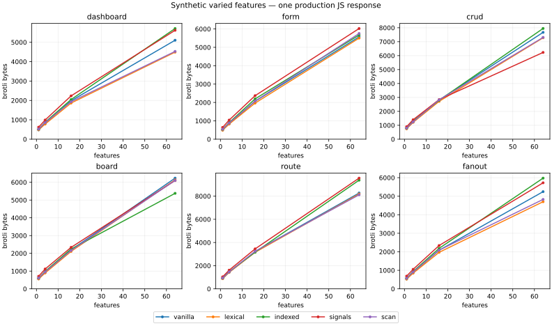

# 105 — Compile UI apps to vanilla: preserve instances and edits

*2026-10-15. Research for [issue #172](https://github.com/canassa/beni/issues/172),
not an adopted language or platform change. Base `f1ab9cc87`; Apple M2 Pro,
macOS arm64, Node 24.19.0, Terser 5.51.2. Chrome version, source/output hashes,
raw samples and fits are retained in
[`bench/compile-to-vanilla/results/`](../../../bench/compile-to-vanilla/results/).
105 was the next free research number on origin/master; no PR was open when
it was chosen. Read the answer sections of 100–104 first.*

## 0. Answer

**Bet on shared instance factories with statically connected local patch
functions, and carry proven array edits all the way to DOM edits. Keep a
small, scoped dynamic fallback. Do not bet on expanding the whole application,
a global rescan, or removing all reactive runtime regardless of cost.** This is
a recommendation for the next discriminating prototype, not approval to
replace browser-direct. An equivalent Conduit and the hard language guarantees
have not been compiled by this experiment.

The two strongest new observations concern *where work belongs*:

- **Sharing a factory matters even after brotli.** Repeating one dashboard
  factory 64 times ships **491 B**; expanding the same factory for every
  instance ships **3,732 B**. Repeated route panels are **880 vs 7,735 B**.
  Compression does not make expanded closures, bindings and wiring free.
  In this controlled experiment, the feature count is known statically; a
  single runtime loop is the fair representation of repeated instances.
- **An edit is more useful than “this list changed.”** With 10,000 rows, 30
  edits cost **49.385 ms** with a generic keyed pass and **3.605 ms** with
  direct edits. Thirty swaps cost **234.105 vs 3.710 ms**. Both include one
  forced layout per batch; these are not single-click latencies. The direct
  version is **474 B** brotli versus **534 B** for the keyed version. Its
  model is a plain array in both cases; ownership alone did not remove the
  renderer's scan.

The growth experiment is less one-sided. Across the six synthetic varied
families, lexical patch functions have fitted slopes **62–114 B per feature**,
versus **72–115 B** for inline manual patches, **74–133 B** for a sparse indexed
consumer table, and **78–133 B** for a small signal graph. **The graph beats
lexical on the CRUD size curve**, 6,229 vs 7,280 B at 64 features; the indexed
table beats lexical on the board, 5,378 vs 6,139 B. A compiler should be able
to outline repeated wiring. “No runtime table ever” is not supported.

For a local dashboard edit with 64 distinct feature shapes, 100 event
handlers plus one layout read take **0.245 ms** under both manual and lexical
patching, **0.320 ms** indexed, **0.365 ms** signals, and **3.030 ms** scanning
the page. Those tiny batches distinguish the rescan's growth, not a universal
ranking of the three targeted designs. Full medians and IQRs are in §3 and
[`tables.md`](../../../bench/compile-to-vanilla/results/tables.md).

**No new Conduit floor is claimed.** Research 101's adjusted Solid reference
is not feature-and-guarantee equivalent; research 102's guarantee attribution
is not an unavoidable lower bound. The 0.5–1.0 kB toy pages here do not replace
beni's approximately 15 kB real-app baseline. Their network layer deliberately
implements only same-origin JSON GET, abort and a few precise failures, not
Task, full Http, history navigation, storage and arbitrary dynamic schemas.

## 1. What was explored

The experiment has three independent parts. No compiler source changes or
spec changes were needed.

### 1.1 Representation and feature growth

[`generate.mjs`](../../../bench/compile-to-vanilla/generate.mjs) lowers a tiny
explicit dependency IR: each feature declares state fields, patch reads and
handler writes. Those facts are supplied by the experiment, **not inferred
from beni source**. It produces these executable alternatives:

| Candidate | What ships | What the comparison can establish |
|---|---|---|
| `vanilla` | Patch bodies embedded in the handlers that need them | Manual inlining control for the same operations |
| `lexical` | Instance state and DOM handles in one factory; handlers call the known local patches | Target shape for static analysis without a runtime consumer interpreter |
| `indexed` | A sparse field → patch table per instance and one shared dispatcher, deduplicating multi-field writes | A relatively strong table alternative; **not** today's direct matrix |
| `signals` | One shared dependency tracker; reads register patch observers; reruns unlink and retrack dependencies | Cost of discovering edges at runtime; **not Solid** |
| `scan` | One page-wide set of patches; a nested dispatch marks dirty and the outer dispatch scans once | A conservative fallback with batching, not a deliberately quadratic broadcast |
| `expanded` | Lexical factory bodies duplicated at each instance | Whole-program expansion without sharing; identical to lexical on the varied axis |

All share the same model transitions, templates, DOM primitives and keyed
algorithm. Thus lexical ≈ vanilla is partly true by construction. The
independent table reference in §3.3 addresses that limitation for four
operations. These experiments do not compare six finished frameworks.

The signal graph is synchronous, with no memo DAG or async scheduler. The
indexed table is local and sparse, with no message × global call-site matrix.
Both get shared implementation functions rather than a runtime copied into
every feature. The scan batches nested broadcast handlers into a single scan.
These choices give the alternatives a reasonable chance.

Six families grow at N = 1, 4, 16, 64:

| Family | Feature unit | Behaviors exercised |
|---|---|---|
| CRUD | One list panel, initially 20 records | Append, edit, remove, swap, selection, keyed node identity |
| Form | One controlled field with validation and a save result | Accepted and rejected input, disabled submit, saving |
| Route | One fetch panel and hash destination | Valid JSON, bad shape, invalid JSON, HTTP error, abort on leave/disposal, stale completion |
| Board | One 64-cell board with move and reset | Moving the occupied cell and updating a score |
| Dashboard | One independently addressable widget | Count, derived label, progress, conditional class |
| Fanout | Dashboard widgets plus a broadcast button | One action updates every live widget; disposed widgets leave the broadcast set |

“Fanout” is specifically a broadcast over independent widget states, not a
single shared reactive cell or a diamond graph. “Route” is multiple fetch
panels, not a complete multi-page router. The board is DOM-based, not canvas.

There are two separate growth axes:

- **Repeated:** one shape, created N times by a factory loop. Only the loop
  bound changes in the common shared case. This answers instance growth.
- **Varied:** N separately emitted bodies, with distinct labels and constants,
  eight label categories, varying arithmetic, validation thresholds and some
  dependency sets. This answers a bounded synthetic feature-shape expansion.
  It is **not N unrelated product features** and cannot estimate Conduit's
  future slope. Some families vary much less than others: routes mostly vary
  names/targets; forms mostly vary thresholds. Keep that limitation attached
  to every fitted slope.

A third axis changes one CRUD panel's population to 100, 1,000 and 10,000
rows. It grows runtime work without growing source structure.

### 1.2 Preserve the operation

[`edits.mjs`](../../../bench/compile-to-vanilla/edits.mjs) compares an owned
plain array plus generic keyed reconciliation with the **same transitions**
plus exact edits: append a node, remove a node, swap two nodes, change one
text node, or change the previous and next selected classes. DOM identity is
asserted. No operation is inferred: this is the desired output when a proof
exists, not a claim that the checker already produces it.

The generic reconciler is intentionally simple: cursor-ordered insertion,
not an LIS or crossed-end reconciler. A far swap causes many DOM moves there.
The large swap difference therefore prices **this fallback**, not the best
keyed reconciler, today's direct, or Solid. The independent JFB comparison
uses their own implementations and has much smaller differences. Label edits
and selection still show the cost of scanning all records without a known
operation, independently of the swap algorithm.

### 1.3 An independent vanilla/Solid check

[`table.js`](../../../bench/compile-to-vanilla/table.js) is a hand-written
possible target for the standard table app: shared row factory, local row
handles, owned array, exact updates, direct row listeners, selection handle,
and a reentrancy/defect guard. A generation and liveness flag reject events
for rows removed or superseded by a replacement. It fuses model and renderer
metadata in a row object; that is an additional compiler proof obligation,
not a supported beni representation change.

[`table.mjs`](../../../bench/compile-to-vanilla/table.mjs) uses research 29's
actual operation initialization, real CDP clicks, trace analysis and DOM
postconditions against the pinned upstream vanilla and Solid 2.0.0-rc.9 apps.
It samples create, update every tenth row, swap and remove, at rate 1.
[`static.mjs`](../../../bench/compile-to-vanilla/static.mjs) also uses research
29's 50-section static-heavy page, with 600 list items and 50 dynamic holes,
and its click-plus-flush timing method. Solid gets its actual `flush` inside
the measured interval. The candidate has 50 closures over local counters;
vanilla uses indexed counts and node handles.

Neither is a full official js-framework-benchmark run. The table's JS-only
sizes are provenance, not fair download comparisons: vanilla and the
candidate share an external HTML shell whereas Solid includes that markup in
its JavaScript. The family growth curves include their templates in JS.

## 2. Growth curves

Each generated page is minified identically: Terser module mode, compress
passes 2, identifier mangling, no property mangling. Count one JS response,
brotli quality 11 with size hint; gzip 9 and raw bytes are also retained.
No source maps or test hooks enter that response. The HTML shell and driver
are excluded equally. This is an output-shape experiment with Terser, not
beni's current `--release` pipeline.

Fit `bytes = intercept + slope × features` by ordinary least squares over
1, 4, 16 and 64. The intercept is an extrapolation, **not the empty-page
runtime**. The actual N=1 observation is the baseline reported here.
Residuals and R² are retained for every fit. Compressed size is deterministic
for these inputs, so fit residuals describe curvature, not statistical error.



Brotli bytes, N=1 → N=64; fitted slope in parentheses, bytes/feature:

| Family | Manual | Lexical | Indexed | Signals | Batched scan |
|---|---:|---:|---:|---:|---:|
| Dashboard | 480→5,105 (71.8) | 485→4,491 (62.0) | 520→5,709 (81.0) | 621→5,617 (77.6) | 523→4,529 (61.7) |
| Form | 500→5,571 (79.1) | 493→5,502 (78.3) | 542→5,671 (79.7) | 643→6,024 (83.6) | 544→5,755 (81.5) |
| CRUD | 764→7,670 (107.8) | 750→7,280 (101.8) | 803→7,949 (111.8) | 898→6,229 (81.6) | 800→7,308 (101.4) |
| Board | 562→6,234 (88.8) | 560→6,139 (87.6) | 611→5,378 (73.7) | 708→6,097 (83.8) | 608→6,104 (86.2) |
| Route | 883→8,268 (114.7) | 879→8,185 (113.6) | 932→9,376 (132.6) | 1,037→9,554 (133.3) | 931→8,113 (111.5) |
| Fanout | 533→5,245 (73.0) | 526→4,702 (64.5) | 578→5,975 (84.3) | 687→5,723 (78.2) | 572→4,827 (65.6) |

The lexical fitted intercepts are 588, 532, 826, 564, 996 and 640 B in the
same order. Its R² ranges from 0.988 to 0.998. The complete 72-fit table,
including all four measurements rather than just endpoints, is
[`results/tables.md`](../../../bench/compile-to-vanilla/results/tables.md).

The contrary results matter. The signal representation introduces a shared
`graph(state)` boundary and uniform string-keyed reads; the indexed board
outlines dispatch. The compressed result can beat many independently named
lexical bindings. This is an observation about these complete bundles, not a
proof that signals inherently compress better for all CRUD applications. It
suggests pricing *shared typed factory/wiring shapes* before paying for every
binding separately. It does not justify exporting the whole compiler analysis
as runtime data.

For repeated shapes, lexical N=64 is 491 / 515 / 755 / 568 / 880 / 545 B
(dashboard, form, CRUD, board, route, fanout). Expanding the same instances
costs 3,732 / 4,770 / 6,544 / 5,377 / 7,735 / 3,943 B. The shared curves are
almost flat; fitting them yields near-zero and occasionally negative slopes
from a few compression bytes. Those slopes are not meaningful product-growth
predictions. [The repeated-shape figure](../../../bench/compile-to-vanilla/results/repeated.svg)
shows the actual points.

**Dead end: universal full expansion.** Terser and brotli do not reconstruct
all the sharing a source generator threw away. Specialize by distinct
behavior/dependency shape; instantiate by runtime data. Unroll only after a
whole-bundle measurement demonstrates a gain. The experiment does not kill
partial evaluation, which can retain shared residual functions.

## 3. Speed and correctness

### 3.1 Family grid

All **306 generated production pages** pass concrete DOM assertions and
cross-candidate comparisons in headless Chrome. Checks cover first/last
feature instances, controlled rejection, correct board movement, list node
identity across swap, selection, add/remove, disposal and stale listeners;
route pages additionally check response validation, bad JSON, HTTP 404,
leaving during a delayed request, and disposal during a request. These are
scenario checks, not a proof or a differential fuzz campaign. Runtime error
events fail the driver.

Nine fresh pages per timing cell, two warm batches then one measured batch,
rotating candidate order. No retries or discarded timing observations. The
1,188 retained samples time programmatic DOM events and **one** forced layout
at batch end. Network and loading time are excluded. Mount/parse/memory costs
are not measured by this grid.

At 64 varied features, median milliseconds per batch:

| Action | Batch | Manual | Lexical | Indexed | Signals | Scan |
|---|---:|---:|---:|---:|---:|---:|
| Dashboard local increment | 100 | 0.245 | 0.245 | 0.320 | 0.365 | 3.030 |
| Form input | 100 | 0.190 | 0.195 | 0.260 | 0.235 | 1.370 |
| Board move | 100 | 0.400 | 0.400 | 0.510 | 0.560 | 1.415 |
| CRUD local label edit | 10 | 0.105 | 0.105 | 0.105 | 0.110 | 2.130 |
| Broadcast to every widget | 100 | 6.940 | 7.210 | 7.130 | 9.050 | 8.315 |

The route timing is repeated leave/no-op after the first leave, including
same-hash assignment. It is retained but not evidence about fetch or navigation
latency. The batch timings are too small for strong percentage parity claims
among targeted strategies. Their full IQRs and N=1 counterparts remain in the
generated tables.

**Dead end: whole-page rescan as the default.** It has competitive bytes,
but makes one local edit depend on unrelated mounted features. Batching
helps broadcast and bursts, but cannot fix that dependency. Retain rescanning
inside an opaque *region*, with the region's lifetime, rather than visiting
the application.

**Not killed: signals and small indexed dispatch.** Both avoid unrelated
feature work. A small constant targeted-dispatch overhead is not evidence
that a whole architecture is structurally too slow. Their byte wins in §2
remain evidence in their favor, and this signal experiment lacks the broader
semantics of Solid's real graph.

### 3.2 Array population

The separate edit experiment verifies 54 fresh pages and takes nine samples
per cell. Each sample follows two warm batches and includes 30 operations
(or 30 append/remove pairs), plus one forced layout:

| Rows | Generic edit | Exact edit | Generic swap | Exact swap |
|---:|---:|---:|---:|---:|
| 100 | 0.600 | 0.100 | 2.400 | 0.120 |
| 1,000 | 4.440 | 0.390 | 21.995 | 0.430 |
| 10,000 | 49.385 | 3.605 | 234.105 | 3.710 |

The direct DOM operation count is constant for an edit/swap; the measured
layout cost still grows with the page. This is not an O(1) click-to-paint
claim. At 10,000 rows selection is 41.580 vs 0.040 ms and append/remove is
82.580 vs 0.230 ms. The synthetic generic fallback's weakness and the absence
of memory measurements prevent generalizing those ratios to a production
framework.

### 3.3 Independent reference runs

Chrome **155.0.8059.80**, nine fresh pages per cell, rotated subject order,
rate 1, no retries. Script milliseconds, median [Q1–Q3]:

| JFB operation | Upstream vanilla | Candidate | Solid 2.0.0-rc.9 |
|---|---:|---:|---:|
| Create 1,000 | 6.891 [6.593–7.137] | 7.128 [6.898–7.447] | 6.051 [5.777–6.201] |
| Update every tenth | 0.404 [0.363–0.424] | 0.403 [0.372–0.449] | 0.947 [0.901–0.977] |
| Swap | 0.221 [0.217–0.234] | 0.205 [0.188–0.222] | 0.712 [0.644–0.720] |
| Remove one | 0.363 [0.347–0.404] | 0.152 [0.151–0.157] | 0.468 [0.438–0.572] |

Creation orders Solid, vanilla, candidate in median script time; the
vanilla/candidate IQRs overlap. Update is effectively tied with vanilla in
this run. Swap has overlapping vanilla/candidate IQRs. Removal favors the
candidate. This makes the target worth testing further; it is not a claim
that it wins every operation or meets a full parity gate.

Native trace totals are much noisier: create is 96.698 [41.625–102.502] ms
vanilla, 98.995 [42.776–101.084] candidate, 92.589 [41.525–101.257] Solid.
Do not turn these bimodal totals into speedup percentages. Full totals for
all four operations are retained. The host is an unpinned local workstation;
there was no concurrent benchmark/build suite during the timing runs.

On the static-heavy page, median of each page's ten 100-event batches,
then median [Q1–Q3] across nine pages:

| Subject | Script ms / 100 events | Layout after each event, ms / 100 events | Mount ms |
|---|---:|---:|---:|
| Vanilla indexed counts/handles | 0.127 [0.125–0.132] | 1.795 [1.762–1.832] | 1.460 [1.450–1.490] |
| Local closures + defect guard | 0.123 [0.117–0.123] | 1.790 [1.765–1.838] | 1.560 [1.530–1.770] |
| Solid 2 | 0.325 [0.322–0.347] | 2.115 [2.098–2.163] | 3.315 [3.185–3.465] |

Each page verifies all 50 holes after 2,300 round-robin increments; all show
46. The script numbers are microbenchmark evidence, not user-visible latency.
Mount timings bracket each implementation's render/mount call rather than its
whole download/parse/startup. The implementations initialize some state outside
that bracket. No parse or heap advantage is inferred from this table.

The final table measurements include lifetime/generation guards added during
self-review. An earlier table run without those guards was superseded by this
changed implementation; it is not pooled into these results.

## 4. The design to try, and the language it implies

The proposed unit is **a state owner and its live consumers**, not a global
message constructor and every call site it could reach. A factory creates
local state, retained DOM handles, patches and typed action entry points.
Each source view expression has one residual patch body, used at mount and
subsequent changes; construction and patching share expressions where their
semantics agree. A handler runs its state transition and invokes only the
local residual patches known to depend on the changed fields. Sibling
instances use the same factory body.

A cross-instance edge is a typed setter/action connection or a maintained
collection of live subscribers where the set is dynamic. It cannot always be
compiled to a direct lexical call: dynamic mounts, recursive components,
first-class functions and user-selected views are real cases. Outline a
small scoped dispatcher or region rescan there. An application-wide theme
change must still visit its actual consumers; local closures do not erase
fanout. Derived aggregates may warrant delta maintenance, but this work has
not measured a shared aggregate or diamond graph.

This combines three ideas, each with a different job:

1. **Partial evaluation of the UI protocol.** Known reads/writes become calls,
   branches and local variables. Analysis metadata is a compiler input, not
   automatically an emitted table. Keep residual functions shared by shape;
   do not clone recursively until the program is expanded.
2. **Instance addressing.** A row event already knows its row. Pass that
   instance's action capability directly, rather than rebuild a global
   message path and rediscover the instance. Preserve a message value when
   the source stores, logs, inspects or queues it; erase only the protocol
   whose observation has been proved absent.
3. **Operation provenance.** Keep `append`, `remove`, `swap`, point update
   and selection changes through lowering as internal edit facts. For a
   directly corresponding DOM collection, compile them into exact edits.
   For filtered/sorted/joined projections, either prove how to translate the
   edit or fall back to reconciliation. An owned array does not prove that
   one view row corresponds to one array slot.

The first language experiment should compare **local pure reducers** with a
new mutable-state surface, rather than adopting the latter on intuition. A
library-shaped sketch, **not proposed valid beni syntax/API**, is:

```beni
counter start =
    Ui.component
        { init = start
        , update = λmsg, count → case msg of
              Increment → count + 1
        , view = λcount → <button onClick={Increment}>{count}</button>
        }
```

Each call creates an instance; an action belongs to that instance. A parent
can pass values and receive typed outward actions. Today TEA supplies a
single root reducer and `Html.map` transports paths through it; local reducers
make the desired ownership and routing explicit without abandoning pure
transitions or exhaustive matches. The compiler might recover the same
boundaries from today's source. If it can, **no new surface syntax is needed**.

An imperative spelling with local `state`/assignment could make writes easier
to analyze, but that is not evidence it is necessary or smaller after lowering.
Nor does this experiment establish a public signal API as necessary. Both
are owner decisions after the same feature is compiled from competing source
forms. The essential contract is stable instance identity and lifetime,
ownership-compatible state, and sound dependencies; not a particular keyword.

### 4.1 The guarantees that must survive specialization

| Guarantee | Required proof or residual mechanism | What the prototypes cover |
|---|---|---|
| Static types and exhaustive matching | Existing checker; eliminating a dispatch preserves all reachable branches | No beni frontend/checker in this experiment |
| Owned plain arrays | Compiler ownership proof; retained snapshots/aliases cannot observe an illicit mutation | Plain arrays edited in place; ownership assumed by construction, not checked |
| Correct page after a transition | Sound read/write connections, structural changes before child patches, derived dependency ordering | Explicit fixed graphs and simple local cases; no recursive/dynamic view proof |
| Controlled elements | Restore the actual property when an edit is rejected, even if model identity/value is unchanged | Rejected text input; not select, reset, IME or all stateful attributes |
| No stale actions | Live instance/generation check or a proof that stale entry is unreachable; detach subscriptions and cancel owned work | Disposed listeners and delayed HTTP completion; table row liveness |
| Managed effects | Reuse Task's ownership, cancellation, scopes and finalization; specialize reachable capabilities without dropping failure paths | Narrow AbortController scope only; no general Task runtime |
| Typed host failures | Preserve each API's documented failure variants, rethrow unknown failures into the defect rule | JSON GET's HTTP, network/body-read, bad JSON/body and abort paths; not all are injected |
| Defects stop the program | Every entry/resumption guarded; teardown owned work; rethrow, never broad catch | Defect guards and request abort; no full crash UI/Task shutdown certification |
| Reentrancy and ordering | Queue reentrant sends, commit structure and values in the required order, preserve after-render work | Table guard queues reentrant sends; family cases do not exercise reentrancy |

A local patch must compare leaf values or use proven edits; object identity is
not a change detector for an array/record mutated in place. A callback that
captures a value snapshot must keep that snapshot's semantics, even when a
neighboring callback uses a live instance action. Before suspension, a state
transition must reach its specified commit point and release mutable borrows;
a fiber resumption reenters through the instance's lifetime and dispatch guard.
This needs reconciliation with the current effects contract before lowering
suspendable actions. No experiment here proves that transformation.

The table is a **proof-obligation map**, not permission to price full guarantees
at zero. In particular, replacing Task with an ad-hoc promise library in the
compiler would not be this proposal. The HTTP toy is an isolated measurement
fixture, not a replacement platform implementation.

## 5. Prior art and ideas not yet earned

**Marko is the closest useful precedent for static connections.** Its docs
explicitly describe a compiler-discovered reactive graph and batched updates;
its example also warns that derived values can be stale inside a handler
until flush. Beni must choose/preserve its own transition and observation
semantics rather than copy those blindly. [Marko reactivity](https://markojs.com/docs/reference/reactivity).

**Solid is a precedent for instance-local execution and runtime edges.** Its
fine-grained model uses signals and observers; components need not reexecute
to update individual DOM properties. Here it is also an actual measured
reference, distinct from the toy `signals` variant. [Solid fine-grained reactivity](https://docs.solidjs.com/advanced-concepts/fine-grained-reactivity).

**Svelte 5 is a reminder that “compiled” need not mean no dynamic graph.**
Its effects track state read during execution and rerun on dependency changes.
Our inference is that a static language can erase edges it proves, while
retaining tracking where it cannot prove them, rather than insisting on one
universal representation. [Svelte effects](https://svelte.dev/docs/svelte/$effect).

**Incremental view maintenance** suggests turning array operations into
changes of derived collections and aggregates. The direct-edit prototype is
only the trivial identity projection. Filter membership, sorting, joins,
shared sums and diamonds are the next hard cases; no database-level algorithm
has been implemented here.

**Server islands, resumability, lazy routes and hydration** address a different
axis: initial or loaded bytes instead of total production code across every
reachable feature. They may help beni, but a server or network boundary is not
free, and these client-only experiments cannot rank Qwik/Marko server modes.
Neither canvas rendering nor Flutter-style retained scenes has been built or
measured here. Those remain alternatives for workloads the DOM families do
not represent; listing them is not evidence against them.

**Supercompilation without a residual sharing limit** is the expansion dead
end measured in §2, but bounded partial evaluation is not. The compiler needs
memoized specialization keys and a fallback when a value/function becomes
unknown. Compiler complexity is permitted; compilation time and code growth
still need measurements before promising an aggressive whole-program pass.

## 6. Getting there from browser-direct

Do not replace the platform first. The earliest useful slice is a **target
output oracle** for one full feature and its awkward boundaries.

1. **Build an equivalent feature vertically.** Hand-lower Conduit's editor,
   feed and article actions into shared factories, retaining the current
   specialized schemas, typed HTTP and Task machinery. Run the existing
   transcripts unchanged, including failing responses and navigation during
   requests. Measure each complete response and all routes. This reveals
   whether the toy baseline advantage survives the guarantees.
2. **Introduce an internal instance/operation IR.** Reuse direct's write-set
   facts and ownership proofs, but attach local patches and proven edits to
   instance boundaries before emission. Keep ordering/liveness explicit.
   Have a dump that explains every fallback. Do not emit a second generic
   view protocol alongside the specialized one by default.
3. **Residualize one local case.** A repeated component/row with static reads
   and local messages should emit one factory and direct action connections.
   Compare the generated output with the target oracle. Where recovery from
   TEA source fails, compare an explicit local-component source form before
   changing the language.
4. **Keep an interoperable scoped fallback.** Current opaque view/update
   behavior remains available, without stale UI or an arbitrary source
   restriction. Crossings carry typed actions/values and lifetime ownership.
   The optimizer should not pull the entire old runtime into a statically
   closed region merely because another region needs it.
5. **Prove operation preservation independently.** Array ownership and
   renderer edits are separate facts. First cover direct list projections,
   then filtered/sorted cases, retaining reconciliation when proofs fail.
   Compare peak memory and parse/mount work as well as bytes and clicks.

This is a possible route to implementation, not a slice plan accepted by the
owner. It changes neither `browser-direct.md` nor the ownership contract.

## 7. The experiments that would confirm or kill the bet

Thresholds below are **proposed decision rules**, not existing gates or
measured promises. The owner chooses them before the next campaign.

1. **The guarantee-complete Conduit ladder.** Match the current editor, then
   reader/feed, then full app with typed failures and Task. Keep one engine
   and one source-feature set. Kill the representation if its app-code slope
   and full bundle both fail to improve on tea/direct after runtime sharing;
   do not subtract a guessed guarantee allowance from Solid. No target of
   13 kB is justified yet.
2. **Unknown boundaries and ownership counterexamples.** Recursive component
   values, a function stored in state, dynamic parent/child action forwarding,
   branch remount, retained snapshots, reentrant messages, cancellation during
   teardown, IME/reset, and diamond-derived reads. Require zero observable
   differences from the current platform under differential fuzzing. A sound
   but common whole-app fallback kills the *size/slope* proposal; a stale
   value kills correctness immediately. Price scoped signals/indexed dispatch
   on the same sources rather than banning them.
3. **Projected collections and real feature diversity.** Implement filtered
   CRUD, sorted board scores and shared dashboard aggregates at several
   feature counts. Add actual unrelated templates, validators, effects and
   routes—not just new labels. Compare generic reconciliation, operation
   deltas and maintained indexes. Reject a default whose local-event work
   grows with unrelated instances or whose index/memory cost erases its byte
   benefit. Runtime data size and source feature size remain separate axes.
4. **Full speed and compiler-cost campaign.** All nine JFB operations and the
   static-heavy page against vanilla and Solid 2, with the established
   protocol, native Chrome, memory and first paint; plus compile time at the
   project's large-source scale. Use per-operation distributions and the
   owner's chosen thresholds, not a geometric mean. The four-operation
   prototype here cannot satisfy that acceptance bar.

The next owner decision is whether to fund experiment 1 plus the adversarial
boundary oracle, with **local factories + operation facts + scoped fallback**
as the hypothesis. There is enough evidence to test that combination. There
is not enough to adopt a new UI language or promise a vanilla-sized Conduit.
