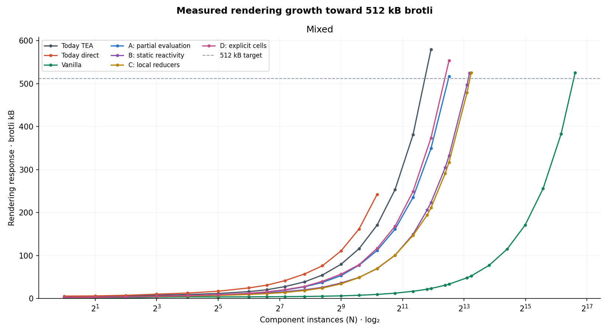
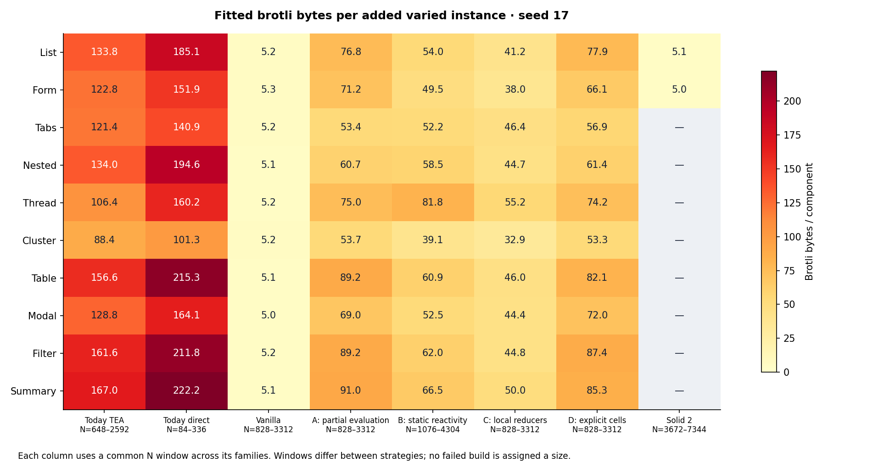

# 106 — Rendering growth from real TEA source

*2026-10-15. Research for [#172](https://github.com/canassa/beni/issues/172), superseding
105. [Generator, source/output examples, protocols and data](../../../bench/rendering-design/README.md).
Compiler `3cca64d`, built ReleaseFast on azathoth; exact identities are retained.*

## 0. Answer

**For this catalogue, prioritize compiler-recognized factory sharing, using C's
local reducers as the starting point and B as the comparator.** At mixed **N=8,768**,
C is **478.85 kB brotli**, B **497.03 kB**, and handwritten-style vanilla
**48.43 kB**. C's advantage over B is only 3.7%; the 9.89× gap to vanilla is much
larger. Vanilla shares configurable factories; the prototypes still emit a
factory for each source component. C with factory sharing remains an unmeasured
compiler hypothesis; the references establish the opportunity, not its savings. Erasing messages is not automatically worth
duplicating arm-specific wiring, and explicit cells have no demonstrated size
advantage here.

The [standalone HTML report](../../../bench/rendering-design/report.html) contains
continuous lines joining actual measurements toward **512 kB brotli per curve**,
local slopes, range-specific intercept/slope/error fits, family comparisons and
downloadable data. The mixed-app crossings are measured: TEA **579.19 kB at
N3,888**, A **516.68 kB at N5,840**, D **553.70 kB at N5,840**, B **524.09 kB
at N9,264**, C **525.61 kB at N9,616**, and vanilla **525.74 kB at N100,352**. Different crossing counts are not
same-size application comparisons; the fixed-N comparison above is.

**The full family sweep is still in progress.** Direct exhausts host memory at
mixed N1,728 before the target ([#203](https://github.com/canassa/beni/issues/203));
Five homogeneous TEA curves initially fail at the later 16 GiB cap. Retrying
nested N3,888 at 24 GiB succeeds: **513.67 kB brotli**. These are budget-dependent
endpoints; further retries are pending. No size is assigned to a failed build.
The webpage preserves both attempts and distinguishes unfinished curves. This follow-up measures size only.

Measured N1 baselines and the original three-seed calibration remain in the
HTML report. Pure-sandbox runtime sizes do not establish full platform parity.

## 1. What was actually generated and proved

Ten structures have their own typed models, message types, reducers and views:
keyed action lists, validated forms, conditional tabs, nested helpers, recursive
comment trees, counter/toggle clusters, sortable tables, modals, input filters,
and derived summaries. Vary fields, labels, nesting, validation thresholds,
step values and which state a message changes. Compose shuffled prefixes at
**N=1,2,4,8,16,32, with seeds 17/101/2027**. Mixed and ten homogeneous families
produce **198 apps, 2,079 component instances and 396 real release builds**.
Both `browser-tea` and `browser-direct` compile exactly that source. In the large
extension, each native curve ends at its target or failure; subsequent prototype
points use per-module BIR dumps without another whole-app build.

The experimental lowerer consumes the real compiler's public BIR. It computes
writes from reducer result records, reads through expressions/helper arguments,
and conservative recursive dependencies. No catalogue entry supplies dependency
sets. Root admission requires byte equality with the generator and a pure-call
allowlist: component separation comes from construction, not general ownership
analysis. Outside sources are rejected.
[Examples](../../../bench/rendering-design/examples/) retain source, BIR,
read/write witnesses, ownership witnesses and all four outputs.

| Direction | Actual executed mechanism |
|---|---|
| A: partial evaluation | Specialize reducer arms; DOM callbacks call local actions without constructing messages; schedule intersecting read/write consumers. |
| B: static reactivity | Keep TEA messages/reducers; instrument actual branch writes with dirty bits; emit static consumer calls. |
| C: local reducers | Keep TEA messages/reducers; closure routes directly to its instance; run that instance's guarded bindings. |
| D: explicit cells | Typed action/transaction proposal; owned cell setters and dynamically tracked binding reads. [Source form](../../../bench/rendering-design/examples/list/Shape0.cells-proposal.beni.txt). |

These executable prototypes are not size lower bounds; all four omit factory
factoring. They share a run-once DOM backend and inferred edit journal, so the direction
comparison isolates state/update wiring. Vanilla is independently written and
shares shape factories with configuration. Solid has independent list/form ports
using its actual JSX compiler, signals, projection selector and keyed `For`.

## 2. Growth, including which shapes hurt

All numbers below are **rendering bytes**, excluding core/List/Task/Schema/Http
and other core spans. Exact source-map attribution deletes core spans, including
inlined ones, then recompresses the rendering response. Executable entries with their dependencies are validated; attribution fragments
are not executable. Prototype `core.mjs` is separately loaded and excluded. Normalize every candidate
with Terser 5.51.2; retain original compiler-release prices too. Brotli quality 11;
raw/gzip and incremental prices are retained. Excluded owned-array helpers cost
137 B brotli standalone. Reclassifying all unmapped spans in a mixed N32 sample
changes prices by ≤164 B without changing rank ([sensitivity](../../../bench/rendering-design/results/sensitivity.json)).

Large-range fits from the current measured endpoints, seed 17:

| Mixed direction | Actual N range | Fitted intercept, B | B/shape | RMSE, B |
|---|---:|---:|---:|---:|
| Today TEA | 512–3,888 | 1,241 | 147.77 | 2,777 |
| Today direct | 512–1,152 | 5,214 | 205.29 | 657 |
| Vanilla | 512–100,352 | 3,127 | 5.20 | 533 |
| A: partial | 512–5,840 | 10,737 | 86.77 | 985 |
| B: static | 512–9,264 | 5,616 | 55.96 | 1,005 |
| C: local | 512–9,616 | 6,170 | 53.70 | 2,437 |
| D: cells | 512–5,840 | 7,874 | 93.57 | 1,313 |

**Composition changes compression.** At the common **N2,592**, C's mixed response
is **146.78 kB**, versus **117.59 kB** averaged across ten homogeneous apps:
**24.8% larger brotli with only 0.01% more raw code**. B changes by −1.2% in
brotli, also with nearly identical raw size. The homogeneous mean is a comparator,
not an additive prediction. This helps explain why C's mixed-app advantage is
much smaller than its single-family advantage; it cautions against generalizing
those slopes. [Comparison](../../../bench/rendering-design/results/stress/graphs/mixture-compression.png).

**The small-app Solid comparison reverses under growth.** For lists, C is smaller
at N512 (23.60 versus 24.79 kB), but Solid is smaller at N768 (26.11 versus
34.41 kB). At N9,632, C is **400.25 kB** versus Solid **71.21 kB**. The form
crossover lies between N336 and N512. Both Solid ports share factories; their
larger fixed runtime stops dominating these repeated-shape workloads.

Ranges differ because curves stop at their own target or compiler limit. The
HTML report also separates small, medium and large fits. These fits describe
observations; they do not supply missing points or predict a failed build.

**These slopes measure varied repetitions of ten templates, not new-feature
cost.** Ranking may change on real applications. An intercept is a fit, not the
runtime floor. Mixed curves flatten when all families appear. Seed ranges are
not confidence intervals. [Full stress fits](../../../bench/rendering-design/results/stress/fits.json)
retain residuals; the original N≤32 calibration remains archived.

Common-window family slopes: brotli bytes per added varied instance, seed 17.
Headers give each strategy's common N window across families; compare shapes
within a column. Direct is censored; Solid has two ports. The live HTML updates
as data arrives.

| Shape | TEA (648–2,592) | Direct (84–336) | A (828–3,312) | B (1,076–4,304) | C (828–3,312) | D (828–3,312) | Vanilla (828–3,312) | Solid (3,672–7,344) |
|---|---:|---:|---:|---:|---:|---:|---:|---:|
| Keyed list | 134 | 185 | 77 | 54 | 41 | 78 | 5.2 | 5.1 |
| Form | 123 | 152 | 71 | 49 | 38 | 66 | 5.3 | 5.0 |
| Tabs | 121 | 141 | 53 | 52 | 46 | 57 | 5.2 | — |
| Nested helpers | 134 | 195 | 61 | 58 | 45 | 61 | 5.1 | — |
| Recursive thread | 106 | 160 | 75 | 82 | 55 | 74 | 5.2 | — |
| Counter/toggle | 88 | 101 | 54 | 39 | 33 | 53 | 5.2 | — |
| Sortable table | 157 | 215 | 89 | 61 | 46 | 82 | 5.1 | — |
| Modal | 129 | 164 | 69 | 52 | 44 | 72 | 5.0 | — |
| Filter | 162 | 212 | 89 | 62 | 45 | 87 | 5.2 | — |
| Derived summary | 167 | 222 | 91 | 67 | 50 | 85 | 5.1 | — |

Tables, filters and summaries drive today's growth: collection traversal,
captures and consumer wiring accumulate. A still pays for summary updates and
recursive helper dependencies. Recursion is the largest slope for B and C;
filters lead D, which adds subscriptions without eliminating binding machinery.
Vanilla and Solid's near-flat slopes expose the missing shared-factory
optimization: the compiler candidates emit distinct factories per source module.
[All family curves](../../../bench/rendering-design/results/stress/graphs/family-growth.png)
include today's output; [fits](../../../bench/rendering-design/results/stress/family-fits.json)
retain actual sample bounds and residuals.

## 3. Correctness and limits

The original campaign validated behavior before pricing the large extension.
The stress extension measures bundle size; it does not claim every enormous DOM
was exercised. Timing artifacts from the earlier campaign remain archived, but
are outside this size-only follow-up.

**1,422 minified pages were checked; 1,394 passed.** All four directions,
vanilla, TEA and the 36 Solid pages matched the exercised TEA observations.
Checks include first/last instances, every instance in mixed N32, rejected inputs,
batched edits and surviving row identity. Twenty-two separate lifetime probes and sixteen complete large-list
checks passed. **Direct fails 28 nested-helper/mixed pages**: its visit invariant stops
dispatch, [#189](https://github.com/canassa/beni/issues/189); failed interactions receive no speed result.

## 4. Proof obligations and the hard case

The compiler must prove message non-observability before A erases it; compose
`Html.map` routing; preserve update order and simultaneous record RHS semantics;
anchor helper reads to the correct instance; prove array uniqueness/no escaping
snapshots before mutation; prove key stability and operation provenance before
local DOM edits; and preserve controlled inputs, branch/row disposal and defect
stop behavior. Exhaustiveness and static types remain the real checker's job.
Factory sharing also needs equivalence modulo configuration, fresh instance
state/captures and preserved nominal boundaries. Effects must retain managed
lifetimes and typed host failures; these pure apps do not demonstrate that extension.

**Hardest: an edited row in a filtered, sorted, recursively nested view whose
parent derives a summary and whose callback outlives a branch.** A changed field
can change membership, order, ancestors and callback captures. Keep general reconciliation and conservative
consumer fallback when the proof is absent. Even a proven DOM edit does not make
a source `List.map` O(1); skipping that traversal needs a further key/index proof.

## 5. Prior art, migration and the confirming experiment

[Actual shared-example compiler outputs](../../../bench/rendering-design/prior-art/README.md)
show what to copy: Solid's run-once template and accessor consumers; Vapor's
`renderEffect`, `createIf` and controlled-input model; Marko's numbered instance
scopes, `_let` setters and statically wired consumers. Do not copy server
resumability into this browser-only comparison. Solid **2 rc.9** here costs about
21.9 kB for the list and 13.1 kB for the form; these are not the old Solid **1.3.3**
Conduit runtime's 5.4 kB.

From direct, first compare B and C within closed constructor-routing regions
using the same run-once factories. Retain the general fallback for escaping messages
and shared state; reuse ownership/edit analysis, controlled inputs and lifetime
checks. Price A/B specialization per region instead of assuming more static
analysis always means smaller output. No language change is required for C.

**One confirming experiment:** lower complete Conduit at six cumulative feature
stages with B, C, and C with factory sharing, retaining its typed host services.
Compare actual rendering bytes against today's TEA at every stage, with identical
minification and accounting. Require equivalent DOM/interaction transcripts,
including alias preservation and changing handler payloads. C must remain smaller
than B on the complete app, and factory sharing must reduce C's final app/wiring
account by at least 20% without increasing its runtime account. These are proposed
acceptance criteria, not estimates from repeated templates. Failure rejects the
corresponding bet; no new language surface is justified by these results alone.

The limits apply once: this is a finite catalogue of pure sandbox shapes, not a
feature-complete Conduit port or a general proof of the lowerer. Cross-component
writes, asynchronous effects and arbitrary stored messages remain unexercised;
Solid's older Conduit has feature differences. The proposed cell surface is not
implemented in beni. The extension measures large bundles directly; it does not
turn repeated templates into a prediction of real feature growth. Do not adopt a
design from these curves alone. No repository gates or suites were run.
