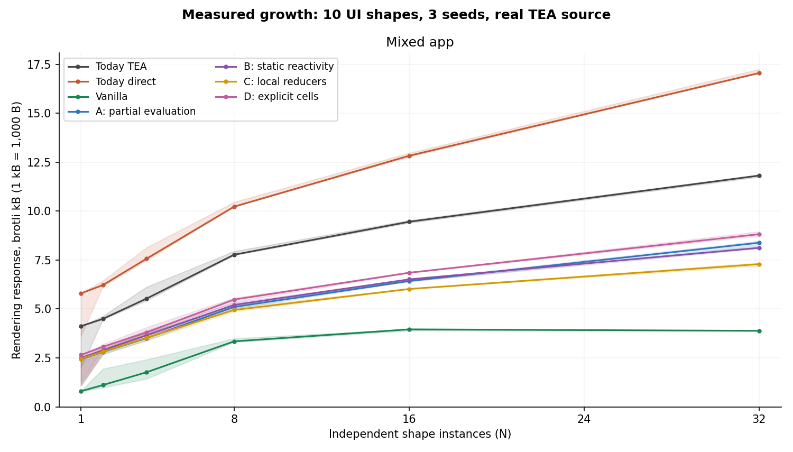
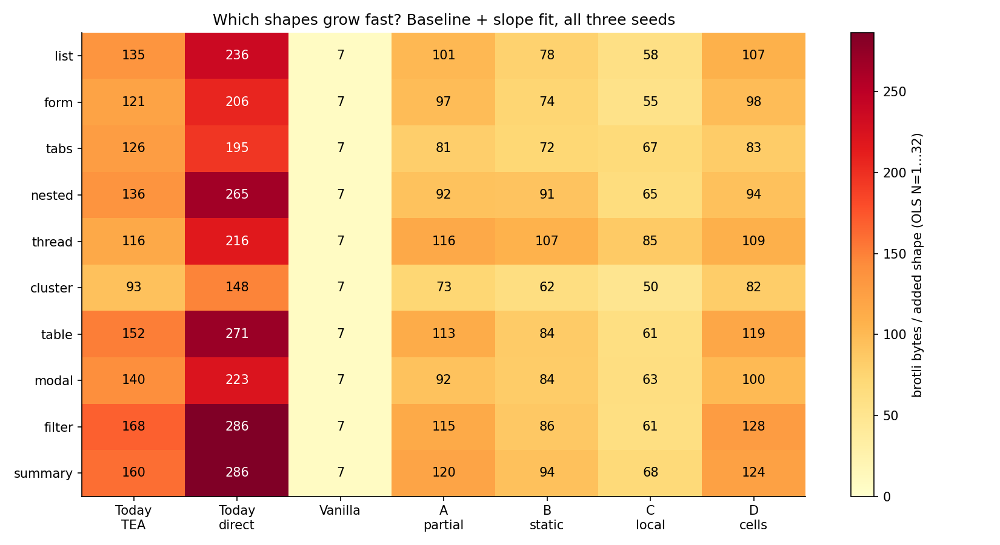

# 106 — Rendering growth from real TEA source

*2026-10-15. Research for [#172](https://github.com/canassa/beni/issues/172), superseding
105. [Generator, source/output examples, protocols and data](../../../bench/rendering-design/README.md).
Compiler `3cca64d`, built ReleaseFast on azathoth; exact identities are retained.*

## 0. Answer

**Bet first on C: instance-local reducers with run-once DOM factories and
ownership-proved array edit propagation. Keep TEA's source semantics.** The
32-component mixed app costs **7.29 kB brotli**, versus **11.82 kB today on TEA,
17.06 kB on direct, and 3.89 kB handwritten vanilla**. C removes 38% of TEA's
rendering bytes and 57% of direct's. It still ships 1.88× vanilla: this is a
promising direction, not the requested vanilla-level result achieved.

The source-derived alternatives lose on bytes: A's message erasure costs
**8.39 kB**, B's static reactivity **8.13 kB**, and D's explicit cells **8.82 kB**.
Erasing dispatch is not automatically worth duplicating arm-specific wiring.
A smaller local dispatcher plus guarded bindings compresses better here. The
explicit-cell language change has no demonstrated byte justification.

**Speed prevents adoption yet.** At 10,000 rows, C edits in **0.98 ms** of script time versus vanilla’s **0.14 ms** and Solid’s **0.23 ms**. Its reverse takes **78 ms**, near vanilla’s **79 ms** and Solid’s **74 ms**, versus today’s roughly **1,560 ms**. Local routing helps; it does not remove the source reducer’s row traversal.
The deciding experiment is a complete, equivalent Conduit rendering lowering,
including editable filtered comment rows and cross-component writes, with a
proven indexed edit path. Keep today's semantic oracle and typed host boundary.

## 1. What was actually generated and proved

Ten structures have their own typed models, message types, reducers and views:
keyed action lists, validated forms, conditional tabs, nested helpers, recursive
comment trees, counter/toggle clusters, sortable tables, modals, input filters,
and derived summaries. Vary fields, labels, nesting, validation thresholds,
step values and which state a message changes. Compose shuffled prefixes at
**N=1,2,4,8,16,32, with seeds 17/101/2027**. Mixed and ten homogeneous families
produce **198 apps, 2,079 component instances and 396 real release builds**.
Both `browser-tea` and `browser-direct` compile exactly that source.

The experimental lowerer consumes the real compiler's public BIR. It computes
writes from reducer result records, reads through expressions/helper arguments,
and conservative recursive dependencies. No catalogue entry supplies dependency
sets. A closed-root recognizer checks fresh instance initializers, disjoint
component ownership and a known pure-call subset. Unknown roots/calls fail.
[Examples](../../../bench/rendering-design/examples/) retain source, BIR,
read/write witnesses, ownership witnesses and all four outputs.

| Direction | Actual executed mechanism |
|---|---|
| A: partial evaluation | Specialize reducer arms; DOM callbacks call local actions without constructing messages; schedule intersecting read/write consumers. |
| B: static reactivity | Keep TEA messages/reducers; instrument actual branch writes with dirty bits; emit static consumer calls. |
| C: local reducers | Keep TEA messages/reducers; closure routes directly to its instance; run that instance's guarded bindings. |
| D: explicit cells | Typed action/transaction proposal; owned cell setters and dynamically tracked binding reads. [Source form](../../../bench/rendering-design/examples/list/Shape0.cells-proposal.beni.txt). |

All four share a run-once DOM backend and inferred edit journal, so the direction
comparison isolates state/update wiring. Vanilla is independently written and
shares shape factories with configuration. Solid has independent list/form ports
using its actual JSX compiler, signals, projection selector and keyed `For`.

## 2. Growth, including which shapes hurt

All numbers below are **rendering bytes**, excluding core/List/Task/Schema/Http
and other core spans. Exact source-map attribution deletes core spans, including
inlined ones, then recompresses the rendering response. Full executable bundles,
not the resulting attribution fragments, are validated. Normalize every candidate
with Terser 5.51.2; retain original compiler-release prices too. Brotli quality 11;
raw/gzip, standalone runtime and incremental app prices are in the data.

| Mixed direction | Fitted intercept, B | B/shape, N=1–32 | B/shape, N=8–32 | N32 rendering runtime alone, B |
|---|---:|---:|---:|---:|
| Today TEA | 4,463 | 254 | 163 | 3,510 |
| Today direct | 5,997 | 371 | 281 | 4,867 |
| Vanilla | 1,557 | 93 | 18 | 740 |
| A: partial | 2,677 | 194 | 133 | 1,788 |
| B: static | 2,823 | 183 | 118 | 1,786 |
| **C: local** | **2,791** | **158** | **94** | **1,787** |
| D: cells | 2,928 | 202 | 138 | 1,980 |

An intercept is a fitted quantity, **not the runtime floor**. Mixed curves bend
when all ten families appear; the upper-range fit is materially flatter. C's
full-range seed slopes are 150–167 B/shape; TEA's are 243–271. These are seed
ranges, not confidence intervals. [Full fits](../../../bench/rendering-design/results/fits.md)
include residuals, which are large for the mixed linear approximation.

Per-family slopes, brotli bytes per added varied instance:

| Shape | TEA | Direct | A | B | C | D | Vanilla |
|---|---:|---:|---:|---:|---:|---:|---:|
| Keyed list | 135 | 236 | 101 | 78 | 58 | 107 | 7 |
| Form | 121 | 206 | 97 | 74 | 55 | 98 | 7 |
| Tabs | 126 | 195 | 81 | 72 | 67 | 83 | 7 |
| Nested helpers | 136 | 265 | 92 | 91 | 65 | 94 | 7 |
| Recursive thread | 116 | 216 | 116 | 107 | 85 | 109 | 7 |
| Counter/toggle | 93 | 148 | 73 | 62 | 50 | 82 | 7 |
| Sortable table | 152 | 271 | 113 | 84 | 61 | 119 | 7 |
| Modal | 140 | 223 | 92 | 84 | 63 | 100 | 7 |
| Filter | 168 | 286 | 115 | 86 | 61 | 128 | 7 |
| Derived summary | 160 | 286 | 120 | 94 | 68 | 124 | 7 |

Filters/summaries drive today's growth: collection traversal, captures and
consumer wiring accumulate. A still pays for summary updates and recursive
helper dependencies; recursion barely improves over TEA. Recursion is C's
largest slope too. D adds subscriptions without eliminating the underlying
binding machinery. Vanilla's near-flat family slopes expose another missing
optimization: shared component factories parameterized by configuration.
These compiler candidates still emit distinct factories per source module.
[All family curves](../../../bench/rendering-design/results/graphs/family-growth.png)
include today's output; Solid appears only for its two actual ports.

## 3. Interactions and correctness

Median script milliseconds; the [interaction chart](../../../bench/rendering-design/results/graphs/interactions.png)
and [full summary](../../../bench/rendering-design/results/timing-summary.json) include all directions and IQRs.

| Operation | TEA | Direct | Vanilla | C: local | Solid 2 |
|---|---:|---:|---:|---:|---:|
| Edit, 1,000 rows | 0.576 | 0.650 | 0.207 | 0.693 | 0.395 |
| Edit, 10,000 rows | 1.129 | 1.399 | 0.143 | 0.980 | 0.230 |
| Select, 10,000 rows | 0.162 | 0.185 | 0.120 | 0.161 | 0.302 |
| Reverse, 10,000 rows | 1,559 | 1,564 | 78.6 | 78.4 | 74.3 |
| Mixed N32: counter | 0.657 | 0.607 | 0.347 | 0.347 | — |
| Mixed N32: submit | 0.406 | 0.377 | 0.388 | 0.399 | — |
| Mixed N32: modal | 0.575 | 0.758 | 0.756 | 0.412 | — |

The reversal gap is tracked in [#194](https://github.com/canassa/beni/issues/194); its cause has not been profiled.
For 10k edits, C's IQR is 0.822–1.068 ms versus vanilla's 0.138–0.150.
For reversal, their IQRs overlap (76.2–78.7 / 78.0–78.9 ms). At 1k rows,
C's edit point estimate is worse than TEA's; do not claim a universal speedup.

Twelve rotated trials on quiet **azathoth**, Xeon E-2386G, Chromium 153.0.8010.36;
driver CPUs 0–1/6–7, Chrome 2–5/8–11. Fresh page per trial/candidate, two warm
cycles, real CDP clicks and trace interval analysis. Tables use script time;
[raw samples](../../../bench/rendering-design/results/timing.json) also retain
click-to-commit and rendering intervals. End-to-end timing includes model/list
work. It is not a separately measured DOM-only cost.

General list permutations use Solid 2 rc.9's actual reconciler. Stable-key edits
use the inferred journal; selection gets an inferred selector fast path. Compare
against actual direct and actual Solid, never a naive scanning substitute.

**1,422 minified pages were checked; 1,394 passed.** All four directions,
vanilla, TEA and the 36 Solid pages matched the exercised TEA observations.
Checks include first/last instances, every instance in mixed N32, rejected inputs,
batched edits and surviving row identity. Twenty-two separate lifetime probes and sixteen complete large-list
checks passed. **Direct fails 28 nested-helper/mixed pages**: its visit invariant stops
dispatch, [#189](https://github.com/canassa/beni/issues/189). Its bytes remain in
the curves; failed interactions receive no speed result.

## 4. Proof obligations and the hard case

The compiler must prove message non-observability before A erases it; compose
`Html.map` routing; preserve update order and simultaneous record RHS semantics;
anchor helper reads to the correct instance; prove array uniqueness/no escaping
snapshots before mutation; prove key stability and operation provenance before
local DOM edits; and preserve controlled inputs, branch/row disposal and defect
stop behavior. Exhaustiveness and static types remain the real checker's job.
Effects retain managed lifetimes and typed host failures at the existing boundary.

**Hardest: an edited row in a filtered, sorted, recursively nested view whose
parent derives a summary and whose callback outlives a branch.** A changed field
can change membership, order, ancestors and callback captures. Direct action
routing alone proves none of those. Keep general reconciliation and conservative
consumer fallback when the proof is absent. Even a proven DOM edit does not make
a source `List.map` O(1); skipping that traversal needs a further key/index proof.

## 5. Prior art, migration and the confirming experiment

[Actual shared-example compiler outputs](../../../bench/rendering-design/prior-art/README.md)
show what to copy: Solid's run-once template and accessor consumers; Vapor's
`renderEffect`, `createIf` and controlled-input model; Marko's numbered instance
scopes, `_let` setters and statically wired consumers. Do not copy server
resumability into this browser-only comparison. Solid **2 rc.9** here costs about
21.9 kB for the list and 13.1 kB for the form; these are not the old Solid **1.3.3**
Conduit runtime's 5.4 kB.

From direct, first lower closed constructor-routing regions into C's local
reducers and run-once factories. Retain the general fallback for escaping messages
and shared state; reuse ownership/edit analysis, controlled inputs and lifetime
checks. Price A/B specialization per region instead of assuming more static
analysis always means smaller output. No language change is required for C.

**Conduit planning projection, not a measurement:** applying the observed
0.5–0.67 local/TEA app-growth ratios to research 104's 7.6 kB view account suggests
**3.8–5.1 kB of view/wiring**, with a **2–3 kB rendering-runtime budget** (1.8 kB
here, plus unrepresented cases). The older Solid reference is 4.8 kB views and
5.4 kB runtime. These separately priced areas must not be added into a promised
bundle total.

**One confirming experiment:** lower complete Conduit with C at six cumulative
feature stages, retaining its typed host services unchanged. Require equivalent
DOM/interaction transcripts, no nested-helper defect, rendering view/wiring
≤5.1 kB and runtime ≤3 kB under the same account, and indexed edits within 15%
of independent vanilla across repeated pinned trials. Failure rejects this bet.

The limits apply once: this is a finite catalogue of pure sandbox shapes, not a
feature-complete Conduit port or a general proof of the lowerer. Cross-component
writes, asynchronous effects and arbitrary stored messages remain unexercised;
Solid's older Conduit has feature differences. The proposed cell surface is not
implemented in beni. Do not extrapolate these curves to 500 kB or adopt a design
from them alone. No repository gates or suites were run.
